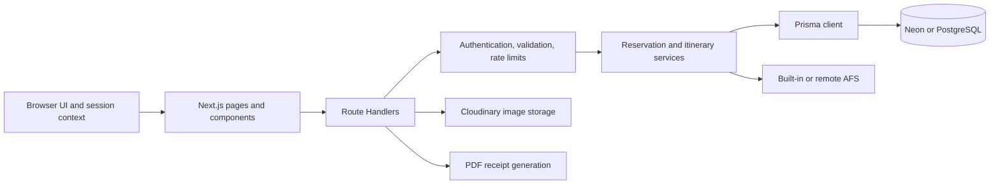

# FlyNext

[English](README.md) | [简体中文](README.zh-CN.md)

[Live demo](https://flynext-puce.vercel.app)

FlyNext is a full-stack travel booking application built as a software engineering portfolio project. It brings flight reservations, hotel stays, itineraries, account management, and hotel-owner workflows into one responsive application. The interface is in English and supports light and dark themes.

The project demonstrates how browser workflows connect to authenticated APIs, transactional PostgreSQL writes, an interchangeable flight provider, and media and receipt services. Flight and hotel records are synthetic demo data. Checkout is a DEMO flow: it does not authorize or transfer money, and the application does not collect real payment-card or passport details.

## Contents

- [Features](#features)
- [Tech stack](#tech-stack)
- [Architecture](#architecture)
- [Engineering highlights and design decisions](#engineering-highlights-and-design-decisions)
- [Getting started](#getting-started)
- [Environment variables](#environment-variables)
- [Scripts and testing](#scripts-and-testing)
- [API conventions](#api-conventions)
- [Flight provider](#flight-provider)
- [Deployment](#deployment)
- [Project structure](#project-structure)
- [Screenshots](#screenshots)
- [Limitations and license](#limitations-and-license)

## Features

| Area | Capabilities |
| --- | --- |
| Flights | Search one-way and return itineraries, book and retrieve tickets, view connecting legs, and cancel reservations. |
| Hotels | Search listings, inspect room types and date-specific availability, create and edit listings, and book or cancel stays. |
| Itineraries | Build an itinerary from reservations, review its running total, and manage the included bookings. An itinerary supports at most one flight reservation and one hotel reservation. |
| DEMO checkout | Confirm an itinerary into an order, preserve its confirmation snapshot, and download a PDF receipt with outbound, return, and connecting flight segments when available. No real payment is processed. |
| Accounts | Register, sign in, manage a profile and avatar, and maintain a refreshable session. |
| Notifications | Read a per-account notification feed and unread count. |
| Hotel owners | Manage owned listings, room types, nightly inventory, and view reservation and availability summaries. Ownership is checked on protected operations. |

Responsive workflows support light and dark themes across desktop, tablet, and mobile layouts. Browser coverage includes traveler and owner tasks, keyboard and focus behavior, accessibility scans, and large synthetic hotel listings.

## Tech stack

| Technology | Use |
| --- | --- |
| Node.js 24, Next.js 15.5.28 App Router and React 19.0.9 | Application runtime, server-rendered web application and API Route Handlers. |
| TypeScript 5 | Strict application, API, and test contracts. |
| Tailwind CSS 4 | Responsive styling and light/dark presentation. |
| PostgreSQL and Prisma 6.3.1 | Relational persistence, schema migrations, transactions, and generated client. |
| Neon | Managed PostgreSQL target for hosted environments and the separately registered integration-test database. |
| Vitest and Playwright | Database-independent unit tests, guarded database integration tests, and browser end-to-end workflows. |
| Cloudinary | Hotel and profile image storage when credentials are configured. |
| pdf-lib and Chart.js | DEMO receipt generation and owner-facing charts. |
| AFS provider contract | Flight search and ticket operations through either the built-in implementation or a configured remote service. |

## Architecture



The `app/` layer renders pages and owns HTTP entry points. Shared API concerns live in `lib/api/`; reservation rules are coordinated in `lib/reservations.ts`; `lib/afs/` implements the offline flight provider and its persistent booking ledger. Prisma schema and migrations define durable application state. The browser calls Route Handlers, which validate input and identity before domain operations read or write PostgreSQL or call an external provider.

## Engineering highlights and design decisions

- **Claim inventory atomically.** Hotel availability is stored per room type and UTC calendar night. A unique `(roomTypeId, date)` constraint prevents split inventory rows. Booking decrements all requested nights with a conditional database update inside a transaction and checks the affected row count; it does not rely on a read-then-write availability check. Cancellation uses a guarded state transition so inventory is restored once.
- **Keep reservation changes consistent.** Database transactions group related reservation, inventory, itinerary, and checkout writes. Flight operations cross a provider boundary, so a failed local write triggers a compensating provider cancellation; unreconciled outcomes are surfaced for operator attention rather than reported as a successful local booking.
- **Make retries safe.** Write endpoints that support idempotent booking or checkout require an `Idempotency-Key`. The key is scoped to the operation and request fingerprint; replaying the same request returns the stored outcome, while reusing a key for different input is a conflict.
- **Protect sessions and guest data.** Access tokens are kept in browser memory. Refresh credentials use an HttpOnly cookie and rotate through server-side refresh-session records. Owner-only guest reservations are returned through ownership-checked endpoints; public hotel and room responses do not expose guest bookings. Sensitive responses are not shared through caches.
- **Use one API error boundary.** Route Handlers use `withRoute` and typed `ApiError` values to return stable JSON errors while keeping internal database details in server logs. Rate-limit responses include `Retry-After`. Deployed authentication and write budgets use atomic PostgreSQL counters across workers; public read limits use bounded process memory.
- **Separate test data from business data.** Database integration and E2E runners validate the registered test target before migration or cleanup and re-check identity at write boundaries. The test database is distinct from development and production targets; its destructive fixtures must never be pointed at a business database.
- **Treat provider and user input as untrusted.** Remote AFS payloads are structurally validated before use. Uploaded images are validated before storage. DEMO checkout rejects real card and passport details.

## Getting started

### Prerequisites

- Node.js 24 and npm (the project was developed against Node 24).
- A dedicated PostgreSQL database for local development, either local PostgreSQL or a separate Neon development database/branch. Do not use a production database.
- Cloudinary credentials only if you want to test real image uploads. The built-in flight provider works without a remote AFS service.

### Install and configure

```sh
npm ci
```

`npm ci` installs the locked dependencies and runs the Prisma Client generation hook. Create `.env` from `.env.example` without replacing an existing file, then set `DATABASE_URL` to the connection string for the dedicated development database. Keep the file private and out of version control. For Neon, use the direct endpoint while running Prisma migration commands; if the application should use a pooled endpoint, switch `DATABASE_URL` back to that endpoint before starting the app. Both endpoints must identify the same dedicated development database.

On PowerShell, create the file only if it does not already exist:

```powershell
if (-not (Test-Path .env)) { Copy-Item .env.example .env }
```

On macOS or Linux, use `cp -n .env.example .env`.

### Initialize the database

For a new, empty development database, verify that `.env` points to that database, then apply the checked-in Prisma migrations and generate the client:

```sh
npx prisma migrate status
npm run prisma:migrate
npm run prisma:generate
```

`prisma:migrate` runs `prisma migrate deploy`; it applies pending migrations and does not reset the database. For an existing database, inspect `npx prisma migrate status` first and confirm the database identity and migration history before applying anything. Do not use a demo/reset seed as a migration step.

The application has eight migrations through `20261020091000_external_recovery`, applied to the current development, developer-test, CI-test, preview and production targets. See the [migration inventory](docs/DEPLOYMENT.md#migration-inventory) for their responsibilities and history checks. The optional standalone AFS maintains its own separate migration history.

The application needs city and airport reference rows for location workflows. If your dedicated development database has not been initialized, `npm run seed:reference` adds reference content in a transaction without deleting rows. This script also creates reference hotels, room types, nightly availability, and may create or update its configured demo owner account; review `SEED_OWNER_EMAIL` and `SEED_OWNER_PASSWORD` behavior before running it. Run it only against the intended development database. It is a database write, not a routine check. See [Development guide](docs/DEVELOPMENT.md) for the project's database safety rules. For hosting and release guidance, see the [deployment guide](docs/DEPLOYMENT.md).

Start the application:

```sh
npm run dev
```

Open `http://localhost:3000`. For the complete configuration reference, see [Environment variables](#environment-variables).

## Environment variables

| Variable | Purpose |
| --- | --- |
| `DATABASE_URL` | PostgreSQL connection used by Prisma. Use the dedicated local development database in `.env`; never copy a production URL into test configuration. |
| `JWT_ACCESS_SECRET` | Long, random signing secret for access tokens. |
| `JWT_REFRESH_SECRET` | Optional legacy refresh-signing setting; refresh sessions use server-side records and an HttpOnly cookie. |
| `JWT_ACCESS_TOKEN_EXPIRY_TIME` | Access-token lifetime, for example `1h`. |
| `JWT_REFRESH_TOKEN_EXPIRY_TIME` | Refresh-cookie lifetime, for example `7d`. |
| `CLOUDINARY_CLOUD_NAME`, `CLOUDINARY_API_KEY`, `CLOUDINARY_API_SECRET` | Cloudinary upload credentials. `CLOUDINARY_URL` is an alternative combined setting; `CLOUDINARY_FOLDER` selects the asset folder. |
| `AFS_BASE_URL`, `AFS_API_KEY`, `AFS_MOCK` | Select and authenticate a remote AFS service, or force the built-in provider. See [Flight provider](#flight-provider). |
| `AFS_LOCAL_AGENCY`, `AFS_SEED_DAYS`, `AFS_LOCAL_API_KEY`, `AFS_DOCKER_*` | Separate generated Docker configuration for the optional AFS service, its synthetic schedule and isolated database; unnecessary for the built-in provider. See the [Docker guide](docs/DOCKER.md). |
| `COMPOSE_PROJECT_NAME`, `FLYNEXT_DOCKER_*` | Generated only in the separate private Docker configuration; identifies the isolated project, database credentials, instance and app port. |

Never commit `.env`, database credentials, signing secrets, Cloudinary keys, or provider API keys. `.env.example` contains placeholders, not working credentials.

## Scripts and testing

| Command | Purpose |
| --- | --- |
| `npm run dev` | Start the Next.js development server. |
| `npm run prisma:generate` | Generate Prisma Client. Also runs after `npm ci`. |
| `npm run prisma:migrate` | Apply pending Prisma migrations to the configured database. This is a database write. |
| `npm run typecheck` | Type-check application code and test code. |
| `npm run lint` | Run ESLint. |
| `npm test` or `npm run test:unit` | Run database-independent Vitest tests. |
| `npm run test:db:verify` | Verify the registered Neon test target before database tests. |
| `npm run test:integration` | Run integration tests against the registered synthetic-data test database. |
| `npm run test:e2e` | Run guarded Playwright E2E workflows; build first with `npm run build`. |
| `npm run build:server` | Compile the standalone server TypeScript output. |
| `npm run build` | Create the Next.js production build. |
| `npm audit --audit-level=high` | Check installed dependency advisories at high severity and above. |

The default `npm test` workflow does not read environment files or connect to a database. Integration and E2E use a verified disposable loopback or separately enrolled Neon `flynext_test` target; they may migrate and clear synthetic test data. Run `test:db:verify`, `test:integration`, and `test:e2e` sequentially, never against a development or production database. E2E starts its own single-worker production server on port 3210 after a build. Read the [Development guide](docs/DEVELOPMENT.md) before running database tests. For a complete local application and isolated PostgreSQL using only Docker Desktop / Compose, follow the [Docker guide](docs/DOCKER.md). It includes separate generated credentials, guarded first-time demo initialization, persistent volumes, an explicit reset command and container business smoke tests. The default, including production, uses the built-in AFS. The optional four-service AFS profile uses a hardened private provider; its isolated configuration, recovery, concurrency checks and persistence commands are in the Docker guide.

The database verification command proves the test target is the enrolled test database; a `_test` name alone is not sufficient. The suite refuses production and unregistered remote targets and rechecks database identity around destructive steps. Do not bypass the repository runners or reuse a running server for E2E. CI database tests require their own separately registered endpoint and restricted role; they are not configured merely by copying a developer's `.env.test`.

## API conventions

- Route Handlers use `withRoute` from `lib/api/handler.ts`; thrown `ApiError` values become JSON error responses with meaningful HTTP statuses.
- Validation, authentication, authorization, conflicts, rate limits, and upstream failures retain distinct status codes. A `429` includes `Retry-After`; internal database details are not returned to callers.
- Expected error bodies use a JSON `{ "error": "..." }` envelope. Common statuses include `400` for invalid input, `401` for unauthenticated requests, `403` for forbidden operations, `404` for missing resources, `409` for conflicts, `429` for rate limits, and `502` for upstream failures.
- JSON numeric fields remain numbers. Clients should use the documented response shape for each resource rather than assuming every successful route wraps its result identically.
- Booking and checkout writes use `Idempotency-Key` where required. Reuse the same key for a retry of the same operation; a different payload requires a new key.
- Authenticated owner reservation data is private and scoped to the currently authorized owner. Public hotel responses never include guest booking records.

## Flight provider

FlyNext implements one AFS client contract with two per-request back ends:

- **Built-in provider:** selected by default when `AFS_BASE_URL` is empty or not a usable service URL. It runs in-process, supports the search and ticket lifecycle, and persists offline bookings in the application database when configured. It makes local development and deployments possible without a separate flight-service deployment; its schedule and tickets are demo data.
- **Remote AFS:** set `AFS_BASE_URL` to a reachable HTTP(S) AFS service and provide `AFS_API_KEY`. A usable `AFS_BASE_URL` selects remote mode unless `AFS_MOCK=true`; `AFS_MOCK=false` requires remote mode and fails if its URL is missing or unusable. Without that explicit flag, an empty or placeholder URL selects the built-in provider. Remote payloads are validated before they enter application logic.

The optional local Compose integration pins [upstream commit b3eee4e](https://github.com/Kianoosh76/afs/commit/b3eee4edd597bfc0545ff99fbbf4e2c0c065b222) and applies the versioned `afs/hardened` overlay with its own lockfile: Next.js 15.5.28, React 19.0.9 and Prisma 6.3.1. Atomic seat accounting, agency-scoped ticket lookup, full references and durable idempotency protect the private provider. FlyNext persists recovery state and reconciles interrupted bookings and cancellations in Docker. See the [Docker guide](docs/DOCKER.md#optional-standalone-afs).

## Deployment

The [hosted demo](https://flynext-puce.vercel.app) runs on Vercel with Node.js 24 and the built-in AFS. Git integration deploys `main` to production and creates branch previews. Configure secrets per environment, use dedicated PostgreSQL targets, and apply reviewed migrations through a controlled release process. Do not run destructive seeds or test fixtures against live data.

See the [deployment guide](docs/DEPLOYMENT.md) for build and release steps.

The maintained documentation has four entry points: this README for architecture and setup, [Development](docs/DEVELOPMENT.md) for testing and CI, [Deployment](docs/DEPLOYMENT.md) for hosted releases and migrations, and [Docker](docs/DOCKER.md) for local containers. Provider maintainers can additionally read [AFS hardening](afs/README.md).

## Project structure

| Path | Responsibility |
| --- | --- |
| `app/` | App Router pages, shared UI, and API Route Handlers. |
| `app/api/` | HTTP endpoints for accounts, flights, hotels, bookings, itineraries, checkout, and owner workflows. |
| `lib/api/` | Request validation, authentication, authorization, rate limiting, idempotency, upload handling, and error responses. |
| `lib/reservations.ts` | Reservation lifecycle and cross-domain booking coordination. |
| `lib/afs/` | Built-in flight provider, durable booking ledger, and provider configuration. |
| `prisma/` | PostgreSQL schema, migrations, and database fixtures. |
| `types/` | Shared TypeScript contracts. |
| `tests/`, `e2e/` | Unit/integration tests and Playwright browser workflows. |
| `scripts/` | Database safeguards, test runners, and maintenance utilities. |
| `docs/` | Development and deployment guides, plus synthetic screenshots. |

## Screenshots

These screenshots use synthetic application data. They are product captures, not evidence of a currently hosted deployment.

| Flight search, desktop | Flight search, mobile | DEMO checkout |
| --- | --- | --- |
|  |  |  |

## Limitations and license

- Checkout is demonstrative only. It does not process real payments, refunds, card numbers, or passport data.
- AFS schedules and ticket inventory are synthetic. Local Compose supports the built-in provider and an optional private AFS service. Real airline ticketing and public cloud AFS operations are outside this local demo. Cloudinary is an optional image storage provider.
- Automated database tests require a separate, isolated test database. See the [development guide](docs/DEVELOPMENT.md) for test setup.
- This is an educational and portfolio project. No formal open-source license is declared; ask the repository owner before commercial reuse.
