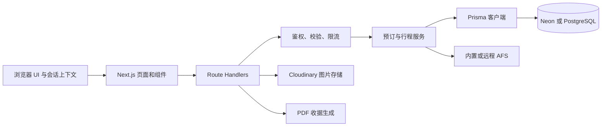
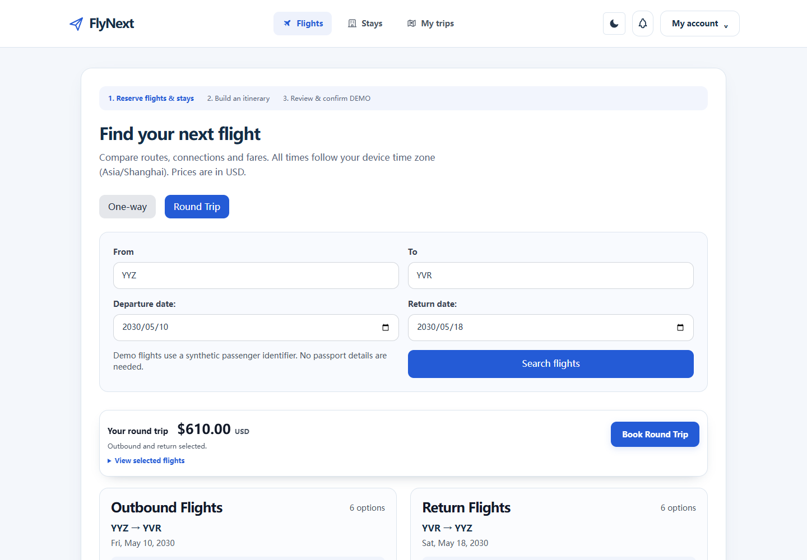
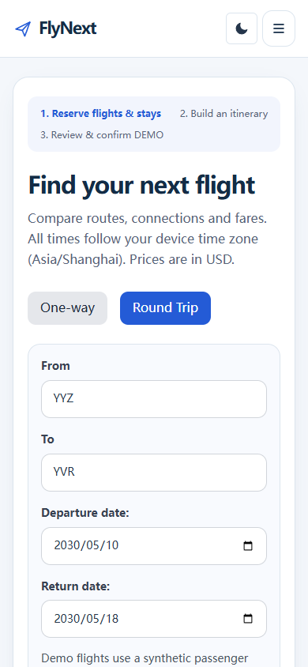
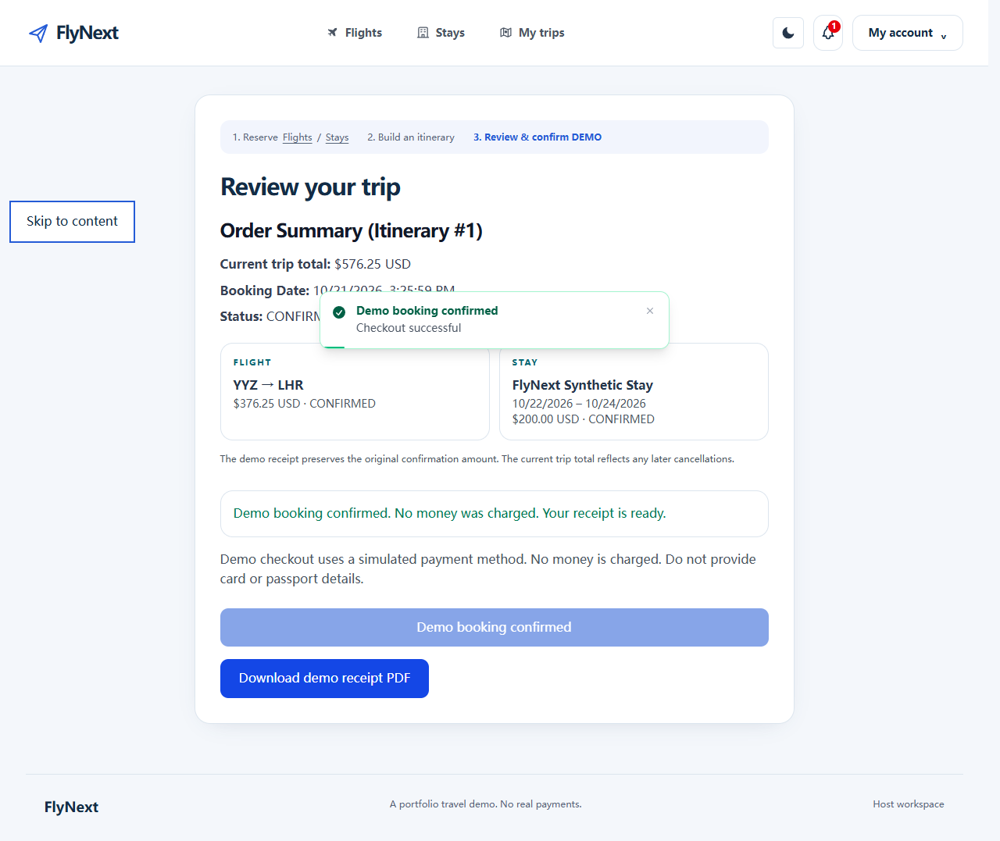

# FlyNext

[English](README.md) | [简体中文](README.zh-CN.md)

FlyNext 是一个全栈旅行预订应用，作为软件工程作品集项目展示。它把航班预订、酒店住宿、行程、账户管理和房主管理流程整合在一个响应式应用中。界面为英语，支持浅色和深色主题。

项目展示浏览器工作流如何连接鉴权 API、PostgreSQL 事务写入、可替换的航班供应商、媒体与收据服务。航班和酒店记录均为合成演示数据。结账仅用于 DEMO 演示：不会授权或转移资金，也不会收集真实银行卡或护照信息。

## 目录

- [功能](#功能)
- [技术栈](#技术栈)
- [架构](#架构)
- [工程亮点与设计决策](#工程亮点与设计决策)
- [快速开始](#快速开始)
- [环境变量](#环境变量)
- [脚本与测试](#脚本与测试)
- [API 约定](#api-约定)
- [航班供应商](#航班供应商)
- [部署](#部署)
- [项目结构](#项目结构)
- [截图](#截图)
- [限制与许可](#限制与许可)

## 功能

| 领域 | 能力 |
| --- | --- |
| 航班 | 搜索单程和往返行程、预订和查询机票、查看中转航段、取消预订。 |
| 酒店 | 搜索房源、查看房型和按日期的库存、创建和编辑房源、预订或取消住宿。 |
| 行程 | 将预订组合进行程、查看合计金额并管理其中的预订。每个行程最多关联一个航班预订和一个酒店预订。 |
| DEMO 结账 | 将行程确认为订单、保留确认快照并下载 PDF 收据；有相应数据时展示去程、返程和中转航段。不处理真实支付。 |
| 账户 | 注册、登录、管理个人资料和头像，并维护可刷新的会话。 |
| 通知 | 查看账户通知及未读数量。 |
| 酒店业主 | 管理自有房源、房型、逐夜库存，并查看预订和可用量摘要。受保护操作会核验所有权。 |

响应式工作流覆盖桌面、平板和移动端布局，并支持浅色与深色主题。浏览器覆盖包括旅客与房主操作、键盘和焦点行为、无障碍扫描以及大型合成酒店列表。

## 技术栈

| 技术 | 用途 |
| --- | --- |
| Next.js 15 App Router 和 React 19 | 服务端渲染的 Web 应用及 API Route Handlers。 |
| TypeScript 5 | 严格的应用、API 和测试契约。 |
| Tailwind CSS 4 | 响应式样式及浅色/深色主题。 |
| PostgreSQL 和 Prisma 6.3.1 | 关系数据持久化、Schema 迁移、事务和生成客户端。 |
| Neon | 托管 PostgreSQL，供托管环境及独立登记的集成测试库使用。 |
| Vitest 和 Playwright | 数据库无关单元测试、受保护的数据库集成测试和浏览器端到端工作流。 |
| Cloudinary | 配置凭据后存储酒店和个人资料图片。 |
| pdf-lib 和 Chart.js | 生成 DEMO 收据和房主图表。 |
| AFS 供应商契约 | 通过内置实现或配置的远程服务执行航班搜索和票务操作。 |

## 架构



`app/` 层负责页面渲染和 HTTP 入口。共享 API 能力位于 `lib/api/`；预订规则由 `lib/reservations.ts` 协调；`lib/afs/` 实现离线航班供应商及其持久化预订账本。Prisma Schema 和迁移定义持久化应用状态。浏览器调用 Route Handlers，后者在访问 PostgreSQL 或调用外部供应商之前校验输入和身份。

## 工程亮点与设计决策

- **原子化占用库存。** 酒店库存按房型和 UTC 日历日期逐夜保存。`(roomTypeId, date)` 唯一约束避免同一夜库存分散在多行中。预订在事务中通过条件更新递减所有入住日期，并检查受影响行数；不依赖先读取、再写入的可竞态库存检查。取消通过受状态保护的转换确保只恢复一次库存。
- **保持预订变更一致。** 数据库事务将相关预订、库存、行程和结账写入组合在一起。航班操作跨越供应商边界，因此本地写入失败时会尝试补偿性取消上游机票；无法自动对账的结果会提示运营人员处理，而不会伪报为本地成功预订。
- **让重试安全。** 支持幂等的预订或结账写入端点要求提供 `Idempotency-Key`。键与操作及请求指纹绑定；相同请求重放会返回已保存结果，同一键用于不同输入则返回冲突。
- **保护会话和客人数据。** 访问令牌保存在浏览器内存中。刷新凭证使用 HttpOnly Cookie，并通过服务端刷新会话记录轮换。仅当前经过所有权校验的房主端点会返回客人预订；公开酒店和房型响应不会暴露客人预订。敏感响应不会通过共享缓存提供。
- **统一 API 错误边界。** Route Handlers 使用 `withRoute` 和类型化 `ApiError` 返回稳定 JSON 错误，数据库内部细节只写入服务端日志。限流响应包含 `Retry-After`。限流器是进程内实现，应视为突发保护，而非分布式配额。
- **隔离测试数据与业务数据。** 数据库集成和 E2E 运行器会在迁移或清理前验证已登记测试目标，并在写入边界再次核验身份。测试库与开发库、生产库分离；具有破坏性的测试夹具绝不能指向业务数据库。
- **将供应商和用户输入视为不可信。** 远程 AFS 响应会先做结构校验再使用。上传图片会先校验再存储。DEMO 结账会拒绝真实银行卡和护照信息。

## 快速开始

### 前置条件

- Node.js 24 和 npm（项目使用 Node 24 开发）。
- 一个专供本地开发的 PostgreSQL 数据库，可以是本机 PostgreSQL，也可以是独立 Neon 开发数据库或分支。不要使用生产数据库。
- 仅当需要测试真实图片上传时才需要 Cloudinary 凭据。内置航班供应商不依赖远程 AFS 服务。

### 安装并配置

```sh
npm ci
```

`npm ci` 安装锁定依赖，并通过安装钩子生成 Prisma Client。将 `.env.example` 复制为 `.env`（不要覆盖已有文件），再将 `DATABASE_URL` 设置为专用开发数据库的连接串。妥善保管该文件，不要提交到版本控制。使用 Neon 时，运行 Prisma 迁移命令期间将 `DATABASE_URL` 设为直连地址；如果应用运行时应使用池化地址，启动应用前再切回池化地址。两个地址必须指向同一个专用开发数据库。

PowerShell 下仅在文件不存在时创建：

```powershell
if (-not (Test-Path .env)) { Copy-Item .env.example .env }
```

macOS 或 Linux 可使用 `cp -n .env.example .env`。

### 初始化数据库

对于新的空开发数据库，先确认 `.env` 指向该数据库，再应用仓库中的 Prisma 迁移并生成客户端：

```sh
npx prisma migrate status
npm run prisma:migrate
npm run prisma:generate
```

`prisma:migrate` 执行 `prisma migrate deploy`；它应用待执行迁移，不会重置数据库。对于已有数据库，先运行 `npx prisma migrate status` 检查状态，并在执行任何迁移前确认数据库身份和迁移历史。不要把演示或重置 Seed 当作迁移步骤。

位置搜索等功能需要城市和机场参考数据。专用开发库尚未初始化时，可运行 `npm run seed:reference`，脚本会在事务中补充参考内容且不会删除数据。该脚本还会创建参考酒店、房型、逐夜库存，并可能创建或更新配置的演示房主账户；运行前请检查 `SEED_OWNER_EMAIL` 和 `SEED_OWNER_PASSWORD` 的行为。只对确认无误的目标开发库运行。它会写入数据库，不是例行检查。数据库安全规则见[开发指南](docs/DEVELOPMENT.md)。部署与发布步骤见[部署指南](docs/DEPLOYMENT.md)。

启动应用：

```sh
npm run dev
```

访问 `http://localhost:3000`。完整配置参见[环境变量](#环境变量)。

## 环境变量

| 变量 | 用途 |
| --- | --- |
| `DATABASE_URL` | Prisma 使用的 PostgreSQL 连接。在 `.env` 中使用专用本地开发库；不要将生产连接串复制到测试配置。 |
| `JWT_ACCESS_SECRET` | 访问令牌的长随机签名密钥。 |
| `JWT_REFRESH_SECRET` | 可选的旧版刷新签名配置；当前刷新会话使用服务端记录和 HttpOnly Cookie。 |
| `JWT_ACCESS_TOKEN_EXPIRY_TIME` | 访问令牌有效期，例如 `1h`。 |
| `JWT_REFRESH_TOKEN_EXPIRY_TIME` | 刷新 Cookie 有效期，例如 `7d`。 |
| `CLOUDINARY_CLOUD_NAME`、`CLOUDINARY_API_KEY`、`CLOUDINARY_API_SECRET` | Cloudinary 上传凭据。`CLOUDINARY_URL` 可作为合并配置；`CLOUDINARY_FOLDER` 设置资源目录。 |
| `AFS_BASE_URL`、`AFS_API_KEY`、`AFS_MOCK` | 选择远程 AFS 服务并进行鉴权，或强制使用内置供应商。参见[航班供应商](#航班供应商)。 |
| `AFS_LOCAL_AGENCY`、`AFS_SEED_DAYS`、`AFS_LOCAL_API_KEY`、`AFS_DOCKER_*` | 可选 AFS 服务、合成时刻表和独立数据库的专用 Docker 生成配置；内置供应商无需配置。参见 [Docker 指南](docs/DOCKER.md)。 |
| `POSTGRES_USER`、`POSTGRES_PASSWORD`、`POSTGRES_DB` | 供可选 Compose 数据库配置使用；连接现有 PostgreSQL 服务时不需要。 |

不要提交 `.env`、数据库凭据、签名密钥、Cloudinary 密钥或供应商 API 密钥。`.env.example` 中只有占位值，不是可用凭据。

## 脚本与测试

| 命令 | 用途 |
| --- | --- |
| `npm run dev` | 启动 Next.js 开发服务器。 |
| `npm run prisma:generate` | 生成 Prisma Client；`npm ci` 后也会自动运行。 |
| `npm run prisma:migrate` | 对已配置数据库应用待执行 Prisma 迁移。此命令会写入数据库。 |
| `npm run typecheck` | 检查应用代码和测试代码的类型。 |
| `npm run lint` | 运行 ESLint。 |
| `npm test` 或 `npm run test:unit` | 运行与数据库无关的 Vitest 测试。 |
| `npm run test:db:verify` | 数据库测试前核验已登记的 Neon 测试目标。 |
| `npm run test:integration` | 在已登记测试库上运行使用合成数据的集成测试。 |
| `npm run test:e2e` | 运行受保护的 Playwright E2E 工作流；先运行 `npm run build`。 |
| `npm run build:server` | 编译独立服务端 TypeScript 产物。 |
| `npm run build` | 创建 Next.js 生产构建。 |
| `npm audit --audit-level=high` | 检查高危及以上级别的依赖安全公告。 |

默认 `npm test` 工作流不会读取环境文件或连接数据库。集成和 E2E 测试使用已核验的专用 loopback 测试库或独立登记的 Neon `flynext_test` 目标，并可能迁移数据库和清理合成测试数据。必须依次运行 `test:db:verify`、`test:integration` 和 `test:e2e`，不能指向开发库或生产库。E2E 在构建后以单 worker 模式启动自己的 3210 端口生产服务器。运行数据库测试前请阅读[开发指南](docs/DEVELOPMENT.md)。仅依赖 Docker Desktop / Compose 的完整应用与独立 PostgreSQL 部署，请参阅 [Docker 使用指南](docs/DOCKER.md)。指南包含独立凭据生成、身份核验、首次完整演示数据初始化、持久化、显式重置和容器业务烟测。默认（包括生产环境）仍使用内置 AFS。可选四服务独立 AFS 使用加固的私有供应商；隔离配置、故障恢复、并发检查和持久化命令见 Docker 指南。

数据库校验命令会验证目标确实是已登记的测试库；仅凭库名带有 `_test` 后缀不足以证明安全。测试套件拒绝生产库和未登记的远程库，并在破坏性操作前后再次核验数据库身份。不要绕过项目运行器，也不要让 E2E 复用已运行的服务器。CI 数据库测试需要另行登记的独立端点和受限角色；复制开发者的 `.env.test` 并不能完成 CI 配置。

## API 约定

- Route Handlers 使用 `lib/api/handler.ts` 中的 `withRoute`；抛出的 `ApiError` 会转换为包含有意义 HTTP 状态码的 JSON 错误响应。
- 校验、鉴权、授权、冲突、限流和上游故障使用不同状态码。`429` 响应包含 `Retry-After`；数据库内部细节不会返回给调用者。
- 预期错误使用 JSON `{ "error": "..." }` 结构。常见状态码包括：输入无效 `400`、未登录 `401`、无权限 `403`、资源缺失 `404`、冲突 `409`、限流 `429` 和上游故障 `502`。
- JSON 数值字段保持为数字。客户端应按各资源文档使用对应的响应形状，不能假设每个成功响应都采用同一种包装。
- 必要的预订和结账写入使用 `Idempotency-Key`。重试同一操作时重复使用原键；不同请求负载需要新键。
- 已鉴权的房主预订数据仅对当前获准的房主开放。公开酒店响应不包含客人预订记录。

## 航班供应商

FlyNext 的 AFS 客户端契约支持两种按请求选择的后端：

- **内置供应商：** 当 `AFS_BASE_URL` 为空或不是有效服务地址时默认使用。它在应用进程内运行，支持搜索及票务生命周期，并在配置数据库时持久化离线预订。开发和部署无需另行部署航班服务；其航班时刻和票务库存均为演示数据。
- **远程 AFS：** 将 `AFS_BASE_URL` 设置为可访问的 HTTP(S) AFS 服务，并提供 `AFS_API_KEY`。有效的 `AFS_BASE_URL` 会选择远程模式，除非设置了 `AFS_MOCK=true`；`AFS_MOCK=false` 明确要求远程模式，地址缺失或无效时会报错。未显式要求远程模式时，地址为空或为占位地址会使用内置供应商。远程响应会在进入应用逻辑前通过结构校验。

可选本地 Compose 集成固定[上游 Commit b3eee4e](https://github.com/Kianoosh76/afs/commit/b3eee4edd597bfc0545ff99fbbf4e2c0c065b222)，并应用版本化的 `afs/hardened` 补丁与独立锁文件：Next.js 15.5.28、React 19.0.9、Prisma 6.3.1。私有供应商通过原子库存操作、代理隔离、完整 reference 和持久化幂等保护票务；FlyNext 在 Docker 中持久化恢复状态，并自动核对中断的预订和取消。操作见 [Docker 指南](docs/DOCKER.md#optional-standalone-afs)。

## 部署

将 Next.js 应用部署到兼容的托管平台。在托管平台的密钥管理功能中配置环境变量，使用专用 PostgreSQL 数据库，并通过受控发布流程应用已审阅的 Prisma 迁移。不要对线上数据运行破坏性 seed 或测试夹具。

构建与发布步骤见[部署指南](docs/DEPLOYMENT.md)。

## 项目结构

| 路径 | 职责 |
| --- | --- |
| `app/` | App Router 页面、共享 UI 和 API Route Handlers。 |
| `app/api/` | 账户、航班、酒店、预订、行程、结账和房主工作流的 HTTP 端点。 |
| `lib/api/` | 请求校验、鉴权、授权、限流、幂等、上传处理和错误响应。 |
| `lib/reservations.ts` | 预订生命周期及跨领域预订协调。 |
| `lib/afs/` | 内置航班供应商、持久化预订账本及供应商配置。 |
| `prisma/` | PostgreSQL Schema、迁移和数据库夹具。 |
| `types/` | 共享 TypeScript 契约。 |
| `tests/`、`e2e/` | 单元/集成测试及 Playwright 浏览器工作流。 |
| `scripts/` | 数据库安全检查、测试运行器和维护工具。 |
| `docs/` | 开发与部署指南，以及合成数据截图。 |

## 截图

截图使用合成数据，展示当前界面，不代表已部署的网站。

| 桌面航班搜索 | 移动端航班搜索 | DEMO 结账确认 |
| --- | --- | --- |
|  |  |  |

## 限制与许可

- 结账仅用于演示，不会处理真实支付、退款、银行卡号或护照信息。
- AFS 航班时刻和票务库存均为合成数据。本地 Compose 支持内置供应商及可选私有 AFS 服务。真实航司出票和公网云端 AFS 运维不属于本地演示范围。Cloudinary 是可选图片存储服务。
- 自动化数据库测试要求使用独立隔离的测试数据库。测试配置见[开发指南](docs/DEVELOPMENT.md)。
- 本项目用于教学和作品集展示。仓库未声明正式开源许可证；商业复用前请先征得仓库所有者同意。
